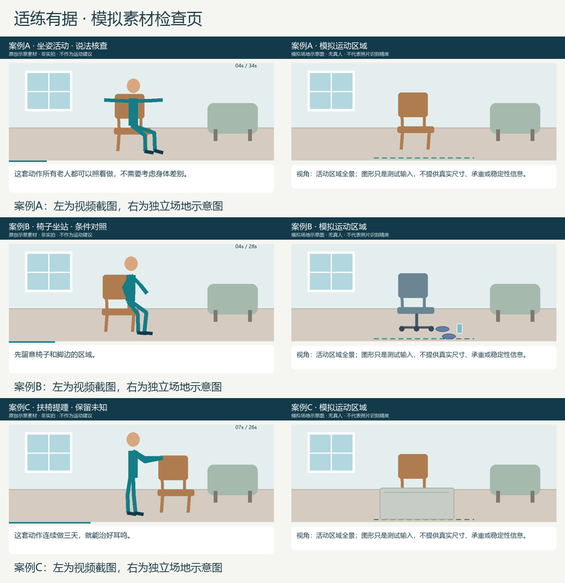

# 样例素材

| 案例 | 视频 | 场地图片 | 用来体验什么 |
|---|---|---|---|
| A 坐姿活动 | `case_a_claims/video.mp4`（约 33 秒） | `scene_clear_*.png` | 夸大保证、不看个人差别等说法的核查 |
| B 椅子坐站 | `case_b_preparation/video.mp4`（约 27 秒） | 调整前 `scene_before_*.png`，调整后 `scene_after_*.png` | 同一视频，不同本人条件和场地，准备提示随之变化 |
| C 扶椅提踵 | `case_c_unknown/video.mp4`（约 25 秒） | `scene_unknown_*.png` | 范围外疗效、否定语境、器材被遮挡时保留“未知” |
| D 真人坐姿 | `real_world/case_d_real_seated/video.mp4`（约 14 秒） | `scene_frame_01~03.jpg` | 多人、遮挡、复杂背景的真人画面 |
| E 真人混合动作 | `real_world/case_e_real_mixed/video.mp4`（约 28 秒） | `scene_frame_01~03.jpg` | 多种动作、使用中的椅子与背景椅子 |

- A—C 为自制的模拟视频与示意图，含刻意编写的待核查说法，中文配音为合成语音，画面标注“不供跟练”。
- D—E 为有许可的真人画面，加自制中文旁白，来源与许可见 `real_world/README.md`。
- `conditions.json` 是虚构的本人条件，可照着在页面中填写；`expected.json` 等文件只用于人工核对，不会发送给模型。
- 这些素材仅用于体验和测试，不是运动建议。
